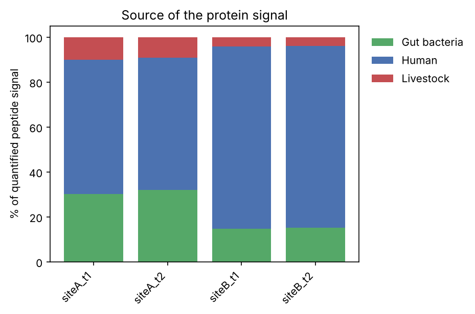

# wastewater-proteomics-nf

A lightweight, reproducible Nextflow pipeline for **shotgun proteomics of
municipal wastewater**, aimed at wastewater-based epidemiology (WBE):

```
PRIDE (RAW) ─► mzML ─► Sage search ─► target-decoy FDR ─► MS1 label-free quant
      │                                                         │
UniProt reference proteomes + cRAP ─► search database           ▼
                                                    peptide taxonomy (human / gut
                                                    bacteria / livestock / rodent)
                                                                │
                              protein quant (Top3) ◄────────────┘
                                       │
          human biomarker + immunoglobulin panel · PCA · group test · HTML report
```



Example report: [`docs/example_report_synthetic.html`](docs/example_report_synthetic.html),
generated by `-profile test`. It is built from **synthetic data with random
sequences**, so it shows what the output looks like, not real results
(download it and open it in a browser). Project page: `docs/index.html`, rebuilt with `python docs/build_page.py`.

It is designed to **run on a laptop** with a handful of RAW files: the aim is
to show a complete, defensible analysis chain, not to reproduce a full study.

## What it answers

1. **Where does the protein signal in wastewater come from?** Share of the
   quantified peptide signal assigned to human, gut bacteria, livestock and
   rodent proteins, using only peptides whose database matches all point to the
   same organism or group.
2. **Which human population-level markers are measurable?** A curated panel
   (`assets/biomarker_panel.tsv`) with uromodulin and albumin (kidney/urine),
   calprotectin (S100A8/A9) and lactoferrin (gut inflammation), and an
   **immunoproteomics block**: secretory IgA (PIGR, IGHA1/2, JCHAIN),
   light chains, IgG and IgM.
3. **Do sites or time points differ?** PCA and an exploratory Welch t-test
   with Benjamini–Hochberg correction when at least two groups have two or
   more samples each.

## Quick start

```bash
# 1. test on synthetic data (no download, ~1 min)
nextflow run kurisutina132/wastewater-proteomics-nf -profile test,conda

# 2. real data: 6 RAW files from a public wastewater metaproteomics study
nextflow run kurisutina132/wastewater-proteomics-nf -profile conda \
    --pride PXD059455 --max_files 6
```

Results end up in `results/`. Open `results/results/report.html`.

### Requirements

* Nextflow ≥ 23.10 and Java 17+
* Either the `conda`/`mamba` profile (`environment.yml`), or these tools on
  your `PATH`:
  * [Sage](https://github.com/lazear/sage) (≥ 0.14)
  * [ThermoRawFileParser](https://github.com/compomics/ThermoRawFileParser)
  * Python 3.10+ with `pandas numpy scipy matplotlib pyteomics psims`
* About 8 to 12 GB of RAM for the `minimal` database. The `full` database,
  which adds livestock and rodents, needs more.

If the binaries live elsewhere, use `--sage_bin /path/to/sage` and
`--trfp_bin /path/to/ThermoRawFileParser`.

## Recommended run on real data

The RAW file names in PRIDE carry the site and date, so inspect them first and
pick a regex that defines the groups:

```bash
python bin/fetch_pride.py --accession PXD059455 --max_files 6
# -> pride_files.tsv (all files with size) and samplesheet.csv (subset)
```

Then either pass `--group_regex '<regex with one capture group>'` or edit
`samplesheet.csv` by hand and run:

```bash
nextflow run . -profile conda --samplesheet samplesheet.csv
```

Check the sample preparation in the PRIDE project (alkylation or not, enzyme)
and set `--carbamidomethyl true/false` to match.

### Samplesheet format

```csv
sample,file,group
siteA_w1,https://ftp.pride.ebi.ac.uk/pride/data/archive/.../file1.raw,siteA
siteB_w1,/data/file2.raw,siteB
siteB_w2,/data/file3.mzML,siteB
```

`file` can be `.raw` or `.mzML`, local or a URL.

## Parameters

| Parameter | Default | Meaning |
|---|---|---|
| `--pride` | – | PRIDE accession; downloads `--max_files` evenly spaced RAW files |
| `--samplesheet` | – | CSV `sample,file,group` |
| `--max_files` | 6 | RAW files taken from PRIDE |
| `--max_file_mb` | 3000 | skip larger RAW files |
| `--group_regex` | – | regex with one capture group applied to file names |
| `--db_set` | `minimal` | `minimal`: human (Swiss-Prot) + 5 gut bacteria + cRAP; `full`: adds B. fragilis, pig, cow, chicken, rat and mouse |
| `--fasta` / `--taxmap` | – | bring your own database |
| `--precursor_ppm` / `--fragment_ppm` | 10 / 20 | Orbitrap HCD defaults |
| `--carbamidomethyl` / `--oxidation` | true / true | fixed C+57 / variable M+16 |
| `--fdr` | 0.01 | PSM and peptide q-value cut-off |
| `--min_peptides` | 2 | unique peptides needed to report a protein |

## Outputs

| File | Content |
|---|---|
| `results/report.html` | self-contained report with every figure and table |
| `qc_per_sample.tsv` | PSMs and peptides at the FDR cut-off, mass error, missed cleavages |
| `peptide_taxonomy.tsv` | each peptide labelled organism-specific, group-specific or ambiguous |
| `taxonomic_composition_pct.tsv` | % of the signal by source |
| `protein_matrix.tsv` | Top3 protein intensities (unique peptides only) |
| `biomarker_panel.tsv` | human biomarker and Ig panel |
| `diff_<g2>_vs_<g1>.tsv` | log2FC, Welch p-value, BH q-value |
| `sage/` | raw Sage output and the exact config used |
| `database/db_manifest.tsv` | proteomes and number of entries in the database |

## Design choices and limitations

* **Sage instead of MSFragger/MaxQuant**: open source, one binary, fast, with
  FDR and LFQ built in, so the pipeline stays light and fully redistributable.
* **Small curated database instead of a metagenome-derived one.** It is
  enough to separate human, animal and bacterial signal, but it
  under-represents the real microbial diversity. Bacterial identifications are
  therefore a lower bound. The proper next step is a two-step or de novo
  focused search against UniRef or a sample-matched metagenome.
* **Peptide taxonomy is limited to the database.** A peptide labelled
  organism-specific is specific *within this database*, not across UniProt.
  An optional Unipept LCA step is on the roadmap.
* **Protein inference uses unique peptides only**, with no razor peptides.
  This is conservative.
* **Statistics are exploratory.** With a few RAW files per group, the t-test
  results are hypotheses, not findings.
* **Synthetic test data** (`-profile test`) uses random sequences. It checks
  that the pipeline works end to end, not that the biology is right.

## Roadmap

- [ ] Unipept `pept2lca` for peptides outside the curated database
- [ ] De novo-guided database reduction (Casanovo) for metaproteomics
- [ ] Targeted assay design: export proteotypic peptides of the panel as a
      Skyline / PRM transition list
- [ ] Normalisation of human markers by population, i.e. testing whether
      uromodulin can serve as a population index, like creatinine or PMMoV
- [ ] Containers (Docker / Singularity) and an nf-test suite

## Data and citation

Example data: PRIDE **PXD059455** (Tugui *et al.*, *Wastewater
metaproteomics: tracking microbial and human protein biomarkers*, ISME
Communications 2025, doi:10.1093/ismeco/ycaf243). Please cite the original
study when you use its data.

Tools: Sage (Lazear, *J. Proteome Res.* 2023, doi:10.1021/acs.jproteome.3c00486),
ThermoRawFileParser (Hulstaert *et al.*, *J. Proteome Res.* 2020), UniProt,
cRAP (The GPM).

## License

MIT
